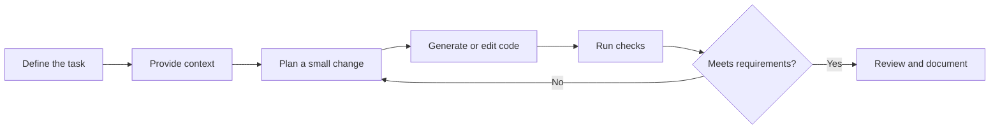

 

  

&nbsp;

&nbsp;

  

---

## ✨ Better Workflows. Better Code.

**Claude Code Best Practices Software** is a developer-focused resource centered on effective ways to work with Claude Code and AI-assisted coding workflows. It brings together the ideas that matter most when using an AI coding assistant: precise task descriptions, thoughtful project context, small verifiable changes, and consistent review.

Whether you're exploring AI-assisted development for the first time or refining an existing workflow, the goal is the same: **make every interaction more useful, every change easier to understand, and every result easier to validate.**

> **The core idea:** AI can accelerate development, but strong engineering habits turn fast suggestions into maintainable software.

## 💎 Why Developers Explore This Approach

| Benefit | Why it matters |
|:--|:--|
| 🎯 **Clearer instructions** | Well-scoped requests reduce ambiguity and unnecessary revisions. |
| 🧭 **Better project context** | Relevant files, constraints, and conventions help guide useful outputs. |
| 🧩 **Smaller iterations** | Focused changes are easier to test, review, and revert. |
| 🛠️ **Faster routine work** | AI assistance can help draft boilerplate, tests, explanations, and refactors. |
| 🔍 **More reliable reviews** | Human checks and automated tests help catch errors before merging. |
| 📚 **Reusable knowledge** | Documented patterns improve consistency across tasks and teams. |

## 🧠 The Best-Practice Toolkit

<table>
<tr>
<td width="50%" valign="top">

### 📝 Prompt Engineering
Define the goal, constraints, expected output, and success criteria before asking for code.

### 🗂️ Context Management
Share the relevant architecture, existing conventions, and only the files needed for the task.

### 🧪 Verification First
Use tests, linting, and direct inspection to evaluate generated changes.

</td>
<td width="50%" valign="top">

### 🔄 Iterative Development
Break complex work into planning, implementation, review, and refinement.

### 🔐 Security Awareness
Avoid exposing secrets; inspect dependencies, commands, and security-sensitive changes.

### 🤝 Team Collaboration
Use readable diffs, descriptive commits, and shared standards for AI-assisted work.

</td>
</tr>
</table>

## 🧬 A Practical AI Coding Workflow

### The five habits that make a difference

1. **Describe the desired result**, not just the immediate problem.
2. **State boundaries** such as language, framework, style, and files to avoid.
3. **Ask for a plan** before broad or risky refactors.
4. **Review the diff** and run the project's checks.
5. **Keep a record** of useful decisions, commands, and recurring patterns.

## 🚀 Get the Project

Interested in exploring **Claude Code Best Practices Software**? Use the button below to visit the project resource.

After opening the resource, review its included materials and follow any setup instructions supplied with the actual project. Use the practices above as a checklist while exploring its content.

## 🧑‍💻 Where It Helps Most

| Scenario | Recommended practice | Outcome |
|:--|:--|:--|
| **New feature** | Define acceptance criteria and plan file changes | More focused implementation |
| **Bug investigation** | Reproduce the issue and provide logs | Easier root-cause analysis |
| **Refactoring** | Preserve behavior and add regression tests | Safer structural improvements |
| **Code review** | Inspect logic, edge cases, and security | Better-informed decisions |
| **Documentation** | Explain intent, setup, and limitations | Easier project onboarding |
| **Learning** | Ask for alternatives and trade-offs | Stronger technical understanding |

## 🎨 Project Preview

## ❓ Frequently Asked Questions

<b>Who is this resource for?</b>

Developers, students, technical teams, and anyone interested in improving AI-assisted coding habits.

<b>Do I need to be an expert to benefit?</b>

No. Beginners can start with task scoping and verification; experienced developers can apply the same principles to complex projects and team workflows.

<b>Can these practices be used in different programming languages?</b>

Yes. Clear instructions, relevant context, incremental changes, and testing are useful across most languages and frameworks.

<b>Does AI-generated code still need review?</b>

Yes. Review and testing remain important parts of a responsible software-development process.

<b>Where do I access the project?</b>

Use any of the project buttons in this README to open the supplied resource link.

---

### Build with intention. Review with confidence.

  

⭐ **Found the ideas useful? Give the repository a star.**

